# Architecture

This follows the *Credit Agent* spec and system diagram. Numbers and letters on the arrows match the diagram's flows.

```mermaid
flowchart LR
    subgraph Browser
        UI[Web UI<br/>SSN form + score ring]
    end
    subgraph Web["web-server :8080 (Spring Boot)"]
        WS[CreditScoreController<br/>CreditScoreService]
    end
    subgraph MCP["credit-report-mcp-server :8082"]
        M[/mcp Streamable HTTP<br/>resource credit-report://ssn/&#123;ssn&#125;<br/>tool get_credit_report/]
    end
    FS[(Credit files<br/>HMAC-named JSON)]
    GEN[credit-report-generator :8083]
    SC[score-calculator :8081<br/>stub: random 400–850]
    subgraph Agents["Agents · LangChain4j · A2A"]
        CA[client-agent :8086]
        CIA[credit-intelligence-agent :8085]
    end

    UI -- "1 · SSN (POST)" --> WS
    WS -- "2 · resources/read" --> M
    M -- "3 · read" --> FS
    WS -- "6 · report" --> SC
    SC -- "7 · score" --> WS
    WS -- "8 · score" --> UI
    GEN -- writes --> FS
    CA -- "A · SSN (A2A SendMessage)" --> CIA
    CIA -- "B · resources/read" --> M
    CIA -- "D · report" --> SC
    CIA -- "F · recommendations" --> CA
```

## Modules

| Module | Role | Key technology |
|---|---|---|
| `common` | SSN value type, credit report model, score bands, HMAC file names, safe logging | Plain Java |
| `service-clients` | MCP client for reports, HTTP client for scores (shared by the web server and the agent) | LangChain4j MCP client, Spring `RestClient` |
| `score-calculator` | `POST /api/v1/scores`: report in, score out | Spring Boot |
| `credit-report-generator` | Creates synthetic reports and writes them to the file store | Spring Boot |
| `credit-report-mcp-server` | MCP server over the file store | LangChain4j `McpServer` (tools) plus resources, Streamable HTTP |
| `web-server` | Serves the UI and orchestrates flow 1–8 | Spring Boot |
| `credit-intelligence-agent` | A2A server: report, then score, then recommendations | a2a-java server, LangChain4j AI service (optional) |
| `client-agent` | A2A client that sends the SSN | LangChain4j `AgenticServices.a2aBuilder` |

## Design decisions

**MCP resource as well as a tool.** LangChain4j's community MCP server only implements tools, and only over stdio. The spec calls for a file-system *resource*. `CreditReportMcpHandler` therefore answers `initialize` and `resources/*` itself, delegates `tools/*` to LangChain4j's `McpServer`, and is served over Streamable HTTP in single-response mode. The project's own clients use the resource. `McpClientContractTest` checks compatibility with the real LangChain4j client.

**A2A server inside Spring Boot.** The a2a-java reference servers are Quarkus-based. `A2aServerConfiguration` wires the SDK's components through its builder API, and `A2aJsonRpcController` mirrors the reference JSON-RPC routes. The agent card advertises `streaming=false`, so the protocol surface is blocking request/response only. `A2aContractTest` drives it with LangChain4j's A2A client.

**Lazy remote connections.** The MCP client and the A2A client both connect on first use and reconnect after a failure. Services can therefore start in any order.

**Two Jackson versions.** Spring Boot 4 uses Jackson 3 (`tools.jackson`) for HTTP and domain JSON. LangChain4j and the MCP protocol objects still use Jackson 2. Each module uses whichever its library expects; the two do not mix.

**Advice: rules first, LLM optional.** The rule-based advisor is deterministic and testable. The LLM advisor (Anthropic through LangChain4j) only ever sees de-identified data, and falls back to the rules if it fails.
