# Architecture

This follows the *Credit Agent* spec and system diagram. Numbers and letters on the arrows match the diagram's flows.

```mermaid
flowchart LR
    subgraph Browser
        UI[Web UI<br/>register with SSN card photo<br/>SSN form + score ring]
    end
    subgraph Web["web-server :8080 (Spring Boot)"]
        WS[CreditScoreController<br/>CreditScoreService]
    end
    subgraph MCP["credit-report-mcp-server :8082"]
        M[/mcp Streamable HTTP<br/>resource credit-report://ssn/&#123;ssn&#125;<br/>tool get_credit_report/]
    end
    FS[(~/Reports/&lt;Bureau&gt;/<br/>Equifax · Experian · TransUnion<br/>HMAC-named JSON)]
    NRG[normalized-report-generator :8084<br/>merges 3 bureau reports]
    GEN[credit-report-generator :8083]
    SC[score-calculator :8081<br/>five-factor scorecard 300–850]
    KYC[kyc-service :8087<br/>dummy KYC provider<br/>blur check + reads SSN from card]
    subgraph Agents["Agents · LangChain4j · A2A"]
        CA[client-agent :8086]
        CIA[credit-intelligence-agent :8085]
    end

    UI -- "1 · SSN (POST)" --> WS
    WS -- "2 · resources/read" --> M
    M -- "3 · read 3 reports" --> FS
    FS -. "4 · 3 bureau files" .-> M
    M -- "5 · 3 reports" --> NRG
    NRG -. "6 · merged" .-> M
    M -. "7 · credit report" .-> WS
    WS -- "8 · report" --> SC
    SC -. "9 · score" .-> WS
    WS -. "10 · score" .-> UI
    GEN -- "writes 3 bureau reports" --> FS
    UI -- "R1 · register + card photo (multipart)" --> WS
    WS -- "R2 · card photo" --> KYC
    KYC -. "R3 · SSN + verification id, or REJECTED (IMAGE_BLURRY…)" .-> WS
    CA -- "A · SSN (A2A SendMessage)" --> CIA
    CIA -- "B · resources/read (runs 3–6)" --> M
    M -. "C · credit report" .-> CIA
    CIA -- "D · report" --> SC
    SC -. "E · score" .-> CIA
    CIA -. "F · recommendations" .-> CA
```



## Modules

| Module | Role | Key technology |
|---|---|---|
| `common` | SSN value type, credit report model, bureau report formats and code tables, score bands, HMAC file names, safe logging | Plain Java |
| `web-support` | Request-size limit filter for services that accept untrusted JSON (score calculator, NRG) | Spring Web |
| `service-clients` | MCP client for reports, HTTP client for scores (shared by the web server and the agent) | LangChain4j MCP client, Spring `RestClient` |
| `score-calculator` | `POST /api/v1/scores`: report in, score out | Spring Boot |
| `kyc-service` | Dummy external KYC provider: `POST /api/v1/ssn-verifications` takes a photo of an SSN card, refuses blurred or non-card images, and returns the SSN it read | Spring Boot, Java ImageIO |
| `credit-report-generator` | Creates a synthetic credit history and writes one report per bureau, each in that bureau's format | Spring Boot |
| `normalized-report-generator` | NRG: `POST /api/v1/normalized-reports`, three bureau reports in, one `CreditReport` out | Spring Boot |
| `credit-report-mcp-server` | MCP server over the file store; reads all three bureau files and has NRG merge them | LangChain4j `McpServer` (tools) plus resources, Streamable HTTP |
| `web-server` | Serves the UI, registers users after a KYC check of their SSN card, logs them in (DynamoDB, JWT), and orchestrates flow 1–10 | Spring Boot, AWS SDK DynamoDB, Nimbus JOSE |
| `credit-intelligence-agent` | A2A server: report, then score, then recommendations | a2a-java server, LangChain4j AI service (optional) |
| `client-agent` | A2A client that sends the SSN | LangChain4j `AgenticServices.a2aBuilder` |

## Design decisions

**MCP resource as well as a tool.** LangChain4j's community MCP server only implements tools, and only over stdio. The spec calls for a file-system *resource*. `CreditReportMcpHandler` therefore answers `initialize` and `resources/*` itself, delegates `tools/*` to LangChain4j's `McpServer`, and is served over Streamable HTTP in single-response mode. The project's own clients use the resource. `McpClientContractTest` checks compatibility with the real LangChain4j client.

**A2A server inside Spring Boot.** The a2a-java reference servers are Quarkus-based. `A2aServerConfiguration` wires the SDK's components through its builder API, and `A2aJsonRpcController` mirrors the reference JSON-RPC routes. The agent card advertises `streaming=false`, so the protocol surface is blocking request/response only. `A2aContractTest` drives it with LangChain4j's A2A client.

**Lazy remote connections.** The MCP client and the A2A client both connect on first use and reconnect after a failure. Services can therefore start in any order, and the retries described under [Resilience](#resilience) cover a dependency that is still starting.

**Two Jackson versions.** Spring Boot 4 uses Jackson 3 (`tools.jackson`) for HTTP and domain JSON. LangChain4j and the MCP protocol objects still use Jackson 2. Each module uses whichever its library expects; the two do not mix.

**Advice: rules first, LLM optional.** The rule-based advisor is deterministic and testable. The LLM advisor (Anthropic through LangChain4j) only ever sees de-identified data, and falls back to the rules if it fails.

## Resilience

Every service-to-service call is bounded, retried when the failure is recoverable, and refused early when the callee is overloaded.

**Timeouts.** Every outbound call has connect and read timeouts (`DOWNSTREAM_TIMEOUT`, 5 s; `KYC_TIMEOUT`, 10 s; `DYNAMODB_TIMEOUT`, 5 s per call including retries). The A2A client waits for the agent's answer with no limit of its own, so the client agent bounds each call itself (`INTELLIGENCE_AGENT_TIMEOUT`, 60 s, enough for an LLM answer).

**Retries with exponential backoff and jitter.** `service-clients` builds every `RestClient` with `RetryingInterceptor`, which uses Spring Framework's `RetryTemplate`. By default a call is tried 3 times, waiting about 100 ms and then 200 ms (doubling, capped at 1 s), each wait lengthened at random by up to 50 ms (Spring never shortens it below the base delay) so that callers which failed together do not all retry together (`CREDIT_RETRY_*`). What is retried depends on whether repeating the call is safe:

| Call | Safe to repeat? | Retried on |
|---|---|---|
| web server → score calculator, agent → score calculator, MCP server → NRG | yes (pure computations) | any I/O failure or timeout; 429, 502, 503, 504 |
| web server, agent → MCP `resources/read` | yes (a read) | transport failures only (the client reconnects). An MCP error answer is not retried: the MCP server already retried NRG, and retrying at both layers would multiply attempts |
| web server → KYC | no (a real provider may bill or record each check) | only failures that prove the request never arrived (connection refused, connect timeout, unknown host), and 429 or 503 |
| client agent → intelligence agent (A2A) | no (it may be running a slow LLM call) | only failures that prove the request never arrived; never after a timeout |
| web server → DynamoDB | yes | the AWS SDK's standard retry mode (3 attempts, exponential backoff with jitter) |

On the last try the caller sees the real failure, and maps it to 503 (or 502 in the client agent) as before. Client errors and 500s are never retried: they would only repeat.

**Admission control: token bucket and bulkhead.** `web-support` adds `InboundLimitFilter` to every service through Boot auto-configuration. A token bucket admits `CREDIT_INBOUND_RATE_PER_SECOND` requests a second (50) with bursts up to `CREDIT_INBOUND_BURST` (100); beyond it a request gets 429 with `Retry-After`. At most `CREDIT_INBOUND_MAX_CONCURRENT` requests (32) run at once; beyond that a request gets 503 with `Retry-After: 1` instead of queueing on a thread. The KYC service, which decodes images in memory, admits 4 at once. Both answers are ones the callers retry with backoff, so a short overload slows callers down instead of failing them. Health checks (`/actuator/*`) are never limited. In the web server the shared limits cover only `/api/*`, so page loads do not use up the bucket, and its per-IP limit (`RATE_LIMIT_PER_MINUTE`) runs first: one client over its own limit is stopped before it can drain the shared bucket and get everyone else refused.

**Body limits.** Every endpoint that reads an untrusted body caps it before reading (`RequestSizeLimitFilter`): score calculator, NRG, KYC, MCP (`/mcp`, 64 KiB) and the A2A endpoint (64 KiB).

## Multi-bureau model

The generator writes each consumer's history three times, to `~/Reports/Equifax/`, `~/Reports/Experian/` and `~/Reports/TransUnion/`, under the same HMAC file name. The bureaus do not publish JSON schemas, so each format is an assumption modelled on public descriptions of their reports and of the Metro 2 furnisher format. The records are in `common/…/bureau/`, and `BureauCodes` holds the code tables both sides use.

| Bureau | Dates | Account type | Status and late payments | Other differences |
|---|---|---|---|---|
| Equifax | `MM/dd/yyyy`, opened `MM/yyyy` | Metro 2 code (`18`, `00`, `26`, `12`, `01`) | Rate `R1`/`I9` (portfolio letter + manner of payment), `closed` flag, 30/60/90 counters | Name split into first/last; SSN last four only |
| Experian | `yyyyMMdd` | Metro 2 code | Status `11` open, `13` closed, `97` charged off; late payments only in the 84-month `paymentProfile` grid (`0`–`3`) | Amounts as strings; names upper case, `LAST, FIRST` |
| TransUnion | ISO `yyyy-MM-dd` | Industry code (`BC`, `FA`, `FM`, `ES`, `FP`) | Rating `01`/`09`, remark `CLOSED`, `historicalCounters` | `creditLimit` null for instalment trades |

The views differ the way real files do: each lender reports to each bureau with 85% probability (always at least one), bureaus last updated an account on different days so older views show older balances, and each hard inquiry appears at exactly one bureau.

**NRG merge rules.** Every report must carry the same SSN last four, or NRG answers 422. Accounts are matched across bureaus by type, creditor (case and punctuation ignored) and account number last four. The balance comes from the newest update. Limit, age and each late counter take the highest value. Status is charged off if any bureau says so, otherwise the newest bureau's status. Inquiries are combined, de-duplicated by subscriber and date, and counted over the 12 months before the newest report. Collections and public records take the highest count. A consumer missing at some bureaus is merged from the ones that have a file.

## User registration and login

```mermaid
sequenceDiagram
    participant UI as Web UI
    participant WS as web-server :8080
    participant K as kyc-service :8087
    participant U as DynamoDB users
    participant S as DynamoDB sessions
    UI->>WS: POST /api/v1/auth/register (multipart: userId, password, email, phone, ssnCard image)
    WS->>WS: check fields, password rules, user id free (400 / 409, no KYC call)
    WS->>K: POST /api/v1/ssn-verifications (multipart: document)
    alt photo blurred, not a card, or unreadable
        K-->>WS: REJECTED + reason (IMAGE_BLURRY, NOT_AN_SSN_CARD, …)
        WS-->>UI: 422 {reason, detail}; UI clears the photo and asks for a new one
    else card verified
        K-->>WS: VERIFIED {ssn, verificationId}
        WS->>U: TransactWriteItems: user (BCrypt hash, SSN HMAC, KYC id) + ssn#hash claim, both if not exists
        WS-->>UI: 201, or 409 if the user id or the SSN is taken
    end
    UI->>WS: POST /api/v1/auth/login {userId, password}
    WS->>U: GetItem userId
    WS->>S: PutItem session (SSN hash, expiresAt = now + 5 min)
    WS-->>UI: JWT (sub = userId, jti = sessionId)
    UI->>WS: POST /api/v1/credit-score {ssn}, Authorization: Bearer JWT
    WS->>S: GetItem jti; refuse if missing or idle 5 min; else refresh expiresAt
    WS->>WS: HMAC(ssn) == session SSN hash? else 403
    WS-->>UI: score (flow 2–10)
    UI->>WS: POST /api/v1/auth/logout
    WS->>S: DeleteItem session
```

**SSN from the card, not the keyboard.** Registration has no SSN field. The user uploads a photo of their Social Security card and the web server sends it to the KYC provider through `IdentityVerifier` (`KycHttpClient`). The SSN bound to the account is the one the provider read, so nobody can claim another person's SSN by typing it. Field, password and user-id checks run first, so a bad form never costs a KYC call. The web server only forwards PNG and JPEG files (by magic bytes) up to 5 MB, and never decodes them itself.

**The dummy KYC provider.** `kyc-service` stands in for an external provider and runs the checks a real one does, in order: the file is a PNG or JPEG of sensible size (pixel count checked from the header before decoding); the photo is sharp enough; it is an SSN card; a valid SSN can be read. Sharpness is the variance of the Laplacian of the grey-scale image scaled to 1000 px wide; below `KYC_MIN_SHARPNESS` (default 100) the answer is `REJECTED` with reason `IMAGE_BLURRY`, and the UI shows "The image is too blurry to read. Take a sharper photo…" and asks for a new photo while keeping the rest of the form. Instead of OCR, it reads a label its own sample cards carry in their PNG metadata, which keeps the demo deterministic. Sample cards come from `GET /api/v1/sample-cards/{ssn}?blur=N` when `KYC_SAMPLE_CARDS_ENABLED=true` (compose only). A sharp sample scores about 1,450, blur 2 about 140 and blur 3 about 48.

| Provider answer | Web server | UI |
|---|---|---|
| `VERIFIED`, SSN, verification id | creates the user (409 if the SSN or id is taken) | logs in |
| `REJECTED` `IMAGE_BLURRY` | 422, `reason: IMAGE_BLURRY` | "too blurry", clears the photo, asks to retry |
| `REJECTED` `UNSUPPORTED_IMAGE`, `IMAGE_SIZE`, `NOT_AN_SSN_CARD`, `SSN_UNREADABLE` | 422 with that reason | the reason's message, asks for a new photo |
| error, timeout, or a malformed answer | 503 | "try again in a few minutes" |

**Tables.** `credit-agent-users` is keyed by `userId` (stored lower case) and holds the BCrypt hash, email, phone, the SSN's HMAC (`ssnHash`) and last four digits, the KYC verification id (`kycVerificationId`), and creation time. The same table holds one `ssn#<hash>` item per user, written in the same transaction, so an SSN cannot be registered twice. The SSN itself is never stored. `credit-agent-sessions` is keyed by `sessionId` and holds `userId`, the SSN hash and last four, `createdAt`, `lastActivityAt` and `expiresAt` (epoch seconds, the table's TTL attribute).

**Own report only.** `CreditScoreController` hashes the requested SSN with the same key and compares it, in constant time, with the session's hash. A mismatch is 403 "You can only look up your own credit report." and happens before the MCP server is called.

**Session end.** A session ends on logout, when a request arrives after 5 idle minutes (the session is deleted and the request refused), or when `SessionSweeper` finds it expired (every minute). DynamoDB's TTL is a last resort, since it can take days. The JWT itself also expires after 1 hour, whatever the activity. To save writes, `lastActivityAt` is refreshed at most every 30 seconds.

**Why not Spring Security.** The app needs one bearer-token filter and a password hasher, so it uses `spring-security-crypto` and Nimbus JOSE directly. Moving to Spring Security's resource server (and OIDC) is the natural next step for production.
