# Architecture

This follows the *Credit Agent* spec and system diagram. Numbers and letters on the arrows match the diagram's flows.

```mermaid
flowchart LR
    subgraph Browser
        UI[Web UI<br/>SSN form + score ring]
    end
    subgraph Web["web-server :8080 (Spring Boot)"]
        WS[CreditScoreController<br/>CreditScoreService]
    end
    subgraph MCP["credit-report-mcp-server :8082"]
        M[/mcp Streamable HTTP<br/>resource credit-report://ssn/&#123;ssn&#125;<br/>tool get_credit_report/]
    end
    FS[(~/Reports/&lt;Bureau&gt;/<br/>Equifax · Experian · TransUnion<br/>HMAC-named JSON)]
    NRG[normalized-report-generator :8084<br/>merges 3 bureau reports]
    GEN[credit-report-generator :8083]
    SC[score-calculator :8081<br/>five-factor scorecard 300–850]
    subgraph Agents["Agents · LangChain4j · A2A"]
        CA[client-agent :8086]
        CIA[credit-intelligence-agent :8085]
    end

    UI -- "1 · SSN (POST)" --> WS
    WS -- "2 · resources/read" --> M
    M -- "3 · read 3 reports" --> FS
    FS -. "4 · 3 bureau files" .-> M
    M -- "5 · 3 reports" --> NRG
    NRG -. "6 · merged" .-> M
    M -. "7 · credit report" .-> WS
    WS -- "8 · report" --> SC
    SC -. "9 · score" .-> WS
    WS -. "10 · score" .-> UI
    GEN -- "writes 3 bureau reports" --> FS
    CA -- "A · SSN (A2A SendMessage)" --> CIA
    CIA -- "B · resources/read (runs 3–6)" --> M
    M -. "C · credit report" .-> CIA
    CIA -- "D · report" --> SC
    SC -. "E · score" .-> CIA
    CIA -. "F · recommendations" .-> CA
```



## Modules

| Module | Role | Key technology |
|---|---|---|
| `common` | SSN value type, credit report model, bureau report formats and code tables, score bands, HMAC file names, safe logging | Plain Java |
| `web-support` | Request-size limit filter for services that accept untrusted JSON (score calculator, NRG) | Spring Web |
| `service-clients` | MCP client for reports, HTTP client for scores (shared by the web server and the agent) | LangChain4j MCP client, Spring `RestClient` |
| `score-calculator` | `POST /api/v1/scores`: report in, score out | Spring Boot |
| `credit-report-generator` | Creates a synthetic credit history and writes one report per bureau, each in that bureau's format | Spring Boot |
| `normalized-report-generator` | NRG: `POST /api/v1/normalized-reports`, three bureau reports in, one `CreditReport` out | Spring Boot |
| `credit-report-mcp-server` | MCP server over the file store; reads all three bureau files and has NRG merge them | LangChain4j `McpServer` (tools) plus resources, Streamable HTTP |
| `web-server` | Serves the UI, registers and logs in users (DynamoDB, JWT), and orchestrates flow 1–10 | Spring Boot, AWS SDK DynamoDB, Nimbus JOSE |
| `credit-intelligence-agent` | A2A server: report, then score, then recommendations | a2a-java server, LangChain4j AI service (optional) |
| `client-agent` | A2A client that sends the SSN | LangChain4j `AgenticServices.a2aBuilder` |

## Design decisions

**MCP resource as well as a tool.** LangChain4j's community MCP server only implements tools, and only over stdio. The spec calls for a file-system *resource*. `CreditReportMcpHandler` therefore answers `initialize` and `resources/*` itself, delegates `tools/*` to LangChain4j's `McpServer`, and is served over Streamable HTTP in single-response mode. The project's own clients use the resource. `McpClientContractTest` checks compatibility with the real LangChain4j client.

**A2A server inside Spring Boot.** The a2a-java reference servers are Quarkus-based. `A2aServerConfiguration` wires the SDK's components through its builder API, and `A2aJsonRpcController` mirrors the reference JSON-RPC routes. The agent card advertises `streaming=false`, so the protocol surface is blocking request/response only. `A2aContractTest` drives it with LangChain4j's A2A client.

**Lazy remote connections.** The MCP client and the A2A client both connect on first use and reconnect after a failure. Services can therefore start in any order.

**Two Jackson versions.** Spring Boot 4 uses Jackson 3 (`tools.jackson`) for HTTP and domain JSON. LangChain4j and the MCP protocol objects still use Jackson 2. Each module uses whichever its library expects; the two do not mix.

**Advice: rules first, LLM optional.** The rule-based advisor is deterministic and testable. The LLM advisor (Anthropic through LangChain4j) only ever sees de-identified data, and falls back to the rules if it fails.

## Multi-bureau model

The generator writes each consumer's history three times, to `~/Reports/Equifax/`, `~/Reports/Experian/` and `~/Reports/TransUnion/`, under the same HMAC file name. The bureaus do not publish JSON schemas, so each format is an assumption modelled on public descriptions of their reports and of the Metro 2 furnisher format. The records are in `common/…/bureau/`, and `BureauCodes` holds the code tables both sides use.

| Bureau | Dates | Account type | Status and late payments | Other differences |
|---|---|---|---|---|
| Equifax | `MM/dd/yyyy`, opened `MM/yyyy` | Metro 2 code (`18`, `00`, `26`, `12`, `01`) | Rate `R1`/`I9` (portfolio letter + manner of payment), `closed` flag, 30/60/90 counters | Name split into first/last; SSN last four only |
| Experian | `yyyyMMdd` | Metro 2 code | Status `11` open, `13` closed, `97` charged off; late payments only in the 84-month `paymentProfile` grid (`0`–`3`) | Amounts as strings; names upper case, `LAST, FIRST` |
| TransUnion | ISO `yyyy-MM-dd` | Industry code (`BC`, `FA`, `FM`, `ES`, `FP`) | Rating `01`/`09`, remark `CLOSED`, `historicalCounters` | `creditLimit` null for instalment trades |

The views differ the way real files do: each lender reports to each bureau with 85% probability (always at least one), bureaus last updated an account on different days so older views show older balances, and each hard inquiry appears at exactly one bureau.

**NRG merge rules.** Every report must carry the same SSN last four, or NRG answers 422. Accounts are matched across bureaus by type, creditor (case and punctuation ignored) and account number last four. The balance comes from the newest update. Limit, age and each late counter take the highest value. Status is charged off if any bureau says so, otherwise the newest bureau's status. Inquiries are combined, de-duplicated by subscriber and date, and counted over the 12 months before the newest report. Collections and public records take the highest count. A consumer missing at some bureaus is merged from the ones that have a file.

## User registration and login

```mermaid
sequenceDiagram
    participant UI as Web UI
    participant WS as web-server :8080
    participant U as DynamoDB users
    participant S as DynamoDB sessions
    UI->>WS: POST /api/v1/auth/register {userId, password, email, phone}
    WS->>U: PutItem if userId not exists (BCrypt hash)
    WS-->>UI: 201, or 409 if taken
    UI->>WS: POST /api/v1/auth/login {userId, password}
    WS->>U: GetItem userId
    WS->>S: PutItem session (expiresAt = now + 5 min)
    WS-->>UI: JWT (sub = userId, jti = sessionId)
    UI->>WS: POST /api/v1/credit-score, Authorization: Bearer JWT
    WS->>S: GetItem jti; refuse if missing or idle 5 min; else refresh expiresAt
    WS-->>UI: score (flow 2–10)
    UI->>WS: POST /api/v1/auth/logout
    WS->>S: DeleteItem session
```

**Tables.** `credit-agent-users` is keyed by `userId` (stored lower case) and holds the BCrypt hash, email, phone and creation time. `credit-agent-sessions` is keyed by `sessionId` and holds `userId`, `createdAt`, `lastActivityAt` and `expiresAt` (epoch seconds, the table's TTL attribute).

**Session end.** A session ends on logout, when a request arrives after 5 idle minutes (the session is deleted and the request refused), or when `SessionSweeper` finds it expired (every minute). DynamoDB's TTL is a last resort, since it can take days. The JWT itself also expires after 1 hour, whatever the activity. To save writes, `lastActivityAt` is refreshed at most every 30 seconds.

**Why not Spring Security.** The app needs one bearer-token filter and a password hasher, so it uses `spring-security-crypto` and Nimbus JOSE directly. Moving to Spring Security's resource server (and OIDC) is the natural next step for production.
